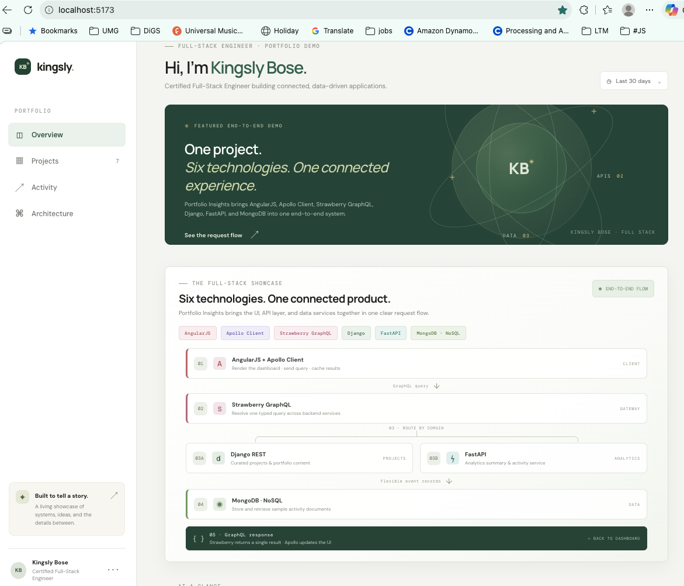
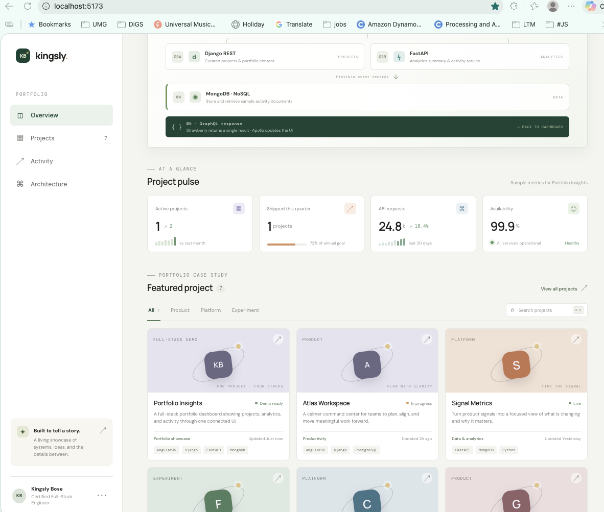
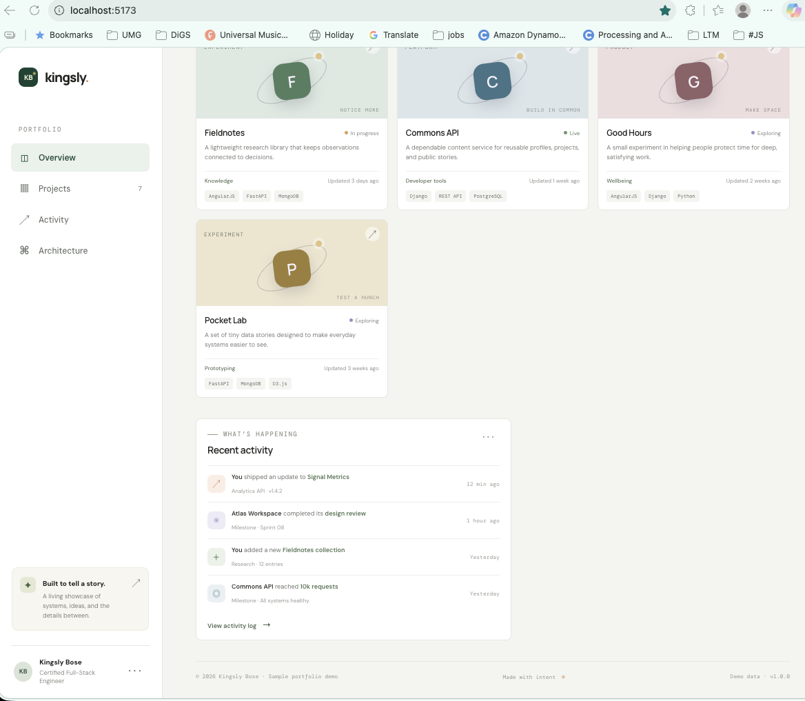
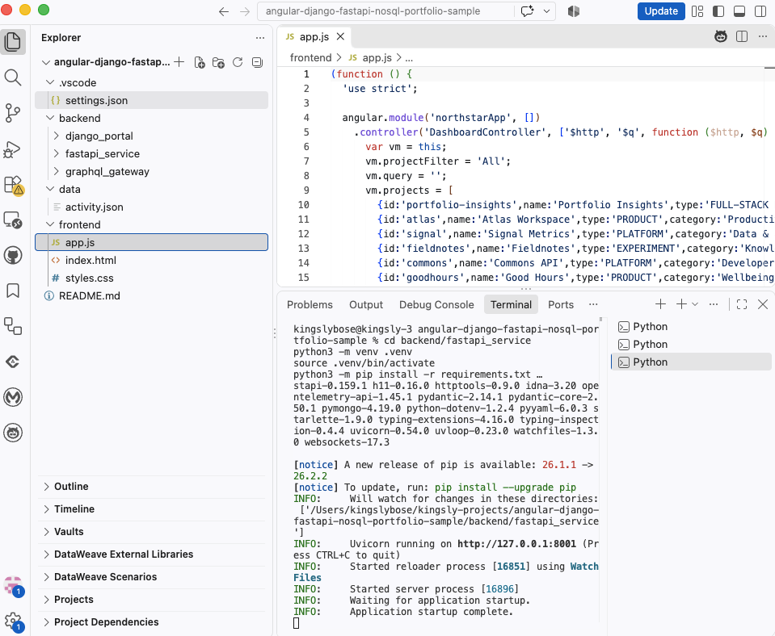
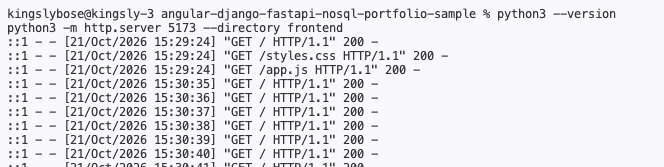
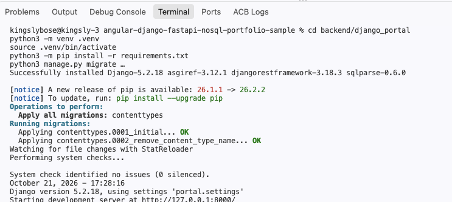
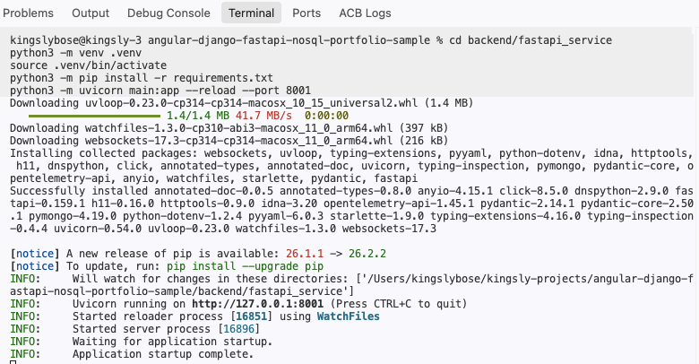

# Portfolio Sample Project — AngularJS, Apollo Client, Strawberry GraphQL, Django, FastAPI & MongoDB

## By Kingsly Bose

> **Portfolio Insights is a full-stack portfolio sample by Kingsly Bose.** The AngularJS interface uses Apollo Client to send a dashboard query through Strawberry GraphQL. The gateway brings together project content from Django REST Framework and analytics/activity from FastAPI, which can read event documents from MongoDB.
>
> This sample highlights Kingsly’s skills in responsive UI development, GraphQL integration, API design, Python services, and NoSQL data handling. All project names, activity, and metrics are fictional demo data. MongoDB is optional; a local JSON fixture supplies sample events by default.

## Technology stack

| Layer | Technology | Role in the sample |
| --- | --- | --- |
| User interface | AngularJS 1.8 + TypeScript | Responsive portfolio dashboard, project cards, search, filters, activity feed, and KPI presentation |
| GraphQL client | Apollo Client 3 | Sends the dashboard query and updates the UI with the combined response |
| GraphQL gateway | Strawberry GraphQL | Provides one typed GraphQL endpoint and composes data from backend services |
| Project API | Django REST Framework | Serves curated project and portfolio content |
| Analytics API | FastAPI | Serves KPI summaries, validated activity records, filters, and pagination |
| NoSQL data | MongoDB | Optional document store for flexible activity/event records |
| Local demo data | JSON | Supplies sample activity when MongoDB is not configured |

## What this sample showcases

- Building a polished, responsive dashboard that presents portfolio work clearly.
- Connecting a browser UI to a GraphQL API with Apollo Client.
- Organizing backend responsibilities across Django and FastAPI services.
- Modeling flexible event data for a NoSQL document store.
- Explaining the complete request and response path through an architecture flow.

## Prerequisites

- **Python 3.10 or newer** and `pip` for Django, FastAPI, and Strawberry GraphQL.
- **A modern web browser** for the UI and GraphQL explorer.
- **A code editor** such as VS Code or PyCharm.
- **Internet access** for the browser CDNs that load AngularJS and, in API mode, Apollo Client.
- **MongoDB (optional):** use a local service or Docker only if you want FastAPI to read event documents from MongoDB. The JSON fixture works without it.

The UI-only demo needs Python and a browser. The complete demo installs Python packages separately in the service virtual environments described below.

The dashboard logic is maintained in `frontend/app.ts` and compiled to `frontend/app.js`, which the page loads directly. The compiled file is committed, so the UI-only demo does not require Node.js. To rebuild after editing the TypeScript source, run `npm install` and `npm run build` from `frontend/`.

## Open and navigate the project

1. Open VS Code (or another editor such as PyCharm) and choose **File → Open Folder**.
2. Select the project root folder, `angular-django-fastapi-nosql-portfolio-sample`.
3. Open `README.md` for setup instructions. Main code locations are `frontend/`, `backend/django_portal/`, `backend/fastapi_service/`, and `backend/graphql_gateway/`.
4. Start with the [UI-only demo](#run-the-ui-only-demo) to view the portfolio without installing backend dependencies.
5. In the browser, use **Overview** to return to the intro, **Architecture** to jump to the technology flow, **Projects** to browse/filter sample cards, and **Activity** to view the sample event feed.
6. To explore the live service flow, follow [Run the complete demo](#run-the-complete-demo), then enable API mode as described in [Connect the UI to the APIs](#connect-the-ui-to-the-apis).

The UI is at **http://localhost:5173**. The GraphQL explorer is at **http://localhost:8002/graphql** when the gateway is running; FastAPI’s API docs are at **http://localhost:8001/docs**.

## Portfolio screenshots

The screenshots below show the running sample UI and the project open in VS Code.

### 1. Portfolio introduction and technology flow



### 2. Featured projects and project cards



### 3. Activity feed and page footer



### 4. Project source and running FastAPI service



### 5. UI development server started



### 6. Django API server started



### 7. FastAPI analytics server started



## Technology and request flow

```text
Browser
  AngularJS dashboard + Apollo Client
              │ GraphQL query
              ▼
  Strawberry GraphQL gateway (:8002)
        ┌─────┴─────────┐
        ▼               ▼
  Django REST API    FastAPI service
  projects (:8000)   analytics/activity (:8001)
                          │
                          ▼
                  MongoDB collection
                  activity documents

  Strawberry combines the service results
              │ GraphQL response
              ▼
  Apollo Client updates the AngularJS dashboard
```

The gateway uses the Django API for project data and the FastAPI service for analytics and activity. FastAPI reads the local JSON fixture by default. When configured with MongoDB, it reads activity documents from the `activity` collection instead. The dashboard’s built-in dummy data also lets the UI run without the backend services.

## Run the UI-only demo

This is the quickest way to view the portfolio. It uses built-in dummy data, so backend services and MongoDB are optional.

From the project root:

```bash
python3 --version
python3 -m http.server 5173 --directory frontend
```

Open **http://localhost:5173**. Leave the terminal running while using the page; press **Ctrl+C** to stop it.

After completing the service setup below, `./scripts/run-demo.sh ui`, `./scripts/run-demo.sh django`, `./scripts/run-demo.sh fastapi`, and `./scripts/run-demo.sh graphql` start the corresponding service with the documented ports.

## Run the complete demo

Use a separate terminal for each service. Start the UI and all three Python services; MongoDB is optional because FastAPI falls back to `data/activity.json`.

### Terminal 1 — AngularJS UI

From the project root:

```bash
python3 -m http.server 5173 --directory frontend
```

Open **http://localhost:5173**. The static page loads AngularJS from Google’s CDN. Apollo Client is imported from esm.sh when API mode is enabled, so API mode requires internet access in the browser.

### Terminal 2 — Django project API

From the project root:

```bash
cd backend/django_portal
python3 -m venv .venv
source .venv/bin/activate
python3 -m pip install -r requirements.txt
python3 manage.py migrate
python3 manage.py runserver 8000
```

The API is at **http://localhost:8000/api/projects/**. Health check: **http://localhost:8000/api/health/**.

### Terminal 3 — FastAPI analytics service

From the project root:

```bash
cd backend/fastapi_service
python3 -m venv .venv
source .venv/bin/activate
python3 -m pip install -r requirements.txt
python3 -m uvicorn main:app --reload --port 8001
```

The interactive API docs are at **http://localhost:8001/docs**. Health check: **http://localhost:8001/health/**.

Activity records support optional `limit`, `offset`, `actor`, `tone`, and `search` query parameters at **http://localhost:8001/api/analytics/activity**. Aggregate event counts are available at **http://localhost:8001/api/analytics/activity/summary**, and matching activity can be exported as CSV at **http://localhost:8001/api/analytics/activity/export**. If a configured MongoDB server is unavailable, the service logs the issue and serves the bundled JSON fixture instead.

### Terminal 4 — Strawberry GraphQL gateway

Start after the Django and FastAPI services:

```bash
cd backend/graphql_gateway
python3 -m venv .venv
source .venv/bin/activate
python3 -m pip install -r requirements.txt
python3 -m uvicorn main:app --reload --port 8002
```

Open **http://localhost:8002/graphql** to explore the GraphQL schema and run queries.

### Optional — MongoDB

Without MongoDB, FastAPI reads the sample event records from `data/activity.json`. To use a local MongoDB instance, start MongoDB separately (Docker example):

```bash
docker run --name portfolio-mongo -p 27017:27017 -d mongo:7
```

Set the connection environment variables before starting FastAPI. For example, from `backend/fastapi_service`:

```bash
export MONGODB_URI='mongodb://localhost:27017'
export MONGODB_DATABASE='northstar_demo'
python3 -m uvicorn main:app --reload --port 8001
```

The demo reads the `activity` collection. If it is empty, the activity endpoint returns an empty list.

## Connect the UI to the APIs

By default, the page uses its local dummy data. To make the page query the running GraphQL gateway, edit `frontend/index.html` and change:

```js
window.DEMO_API_MODE = false;
```

to:

```js
window.DEMO_API_MODE = true;
```

Reload **http://localhost:5173**. Apollo Client sends a single query to **http://localhost:8002/graphql**. Strawberry resolves project data from Django and analytics/activity from FastAPI; FastAPI uses MongoDB if configured and otherwise uses the JSON fixture.

## GraphQL query example

```graphql
query PortfolioDashboard {
  projects {
    id
    name
    status
    tech
  }
  summary {
    activeProjects
    shipped
    apiRequests
    availability
  }
  activity {
    id
    actor
    action
    target
    time
  }
}
```

## Project layout

```text
angular-django-fastapi-nosql-portfolio-sample/
├── .vscode/
│   └── settings.json                 Editor workspace settings
├── README.md                         Project overview and runbook
├── frontend/
│   ├── index.html                    Portfolio page and demo/API mode switch
│   ├── app.js                        AngularJS controller and Apollo query
│   └── styles.css                    Responsive dashboard styling
├── backend/
│   ├── django_portal/
│   │   ├── manage.py                 Django command-line entry point
│   │   ├── requirements.txt          Django and Django REST Framework
│   │   ├── portal/                   Project settings, URLs, and WSGI entry
│   │   └── portal_api/               Dummy project API and health endpoint
│   ├── fastapi_service/
│   │   ├── main.py                   Analytics/activity endpoints and MongoDB fallback
│   │   └── requirements.txt          FastAPI, Uvicorn, and PyMongo
│   └── graphql_gateway/
│       ├── main.py                   Strawberry schema and service resolvers
│       └── requirements.txt          Strawberry, FastAPI, Uvicorn, and HTTPX
├── data/
│   └── activity.json                 Dummy activity events used by default
└── docs/
    └── screenshots/                  README screenshots of UI and service startup
```

`backend/django_portal/db.sqlite3` is created locally when Django migrations run; it is a generated development database, not required in source control.

This is a **portfolio demonstration**, not a production deployment. It is designed to present Kingsly Bose’s full-stack skills through a concrete interface, connected services, and an explained request flow. Names, metrics, project content, and activity shown in the demo are fictional sample data.
